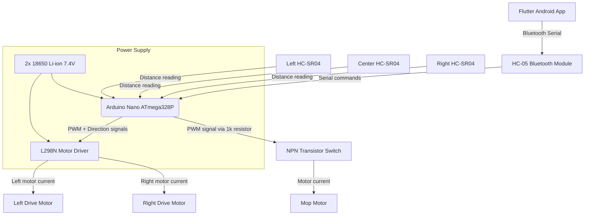
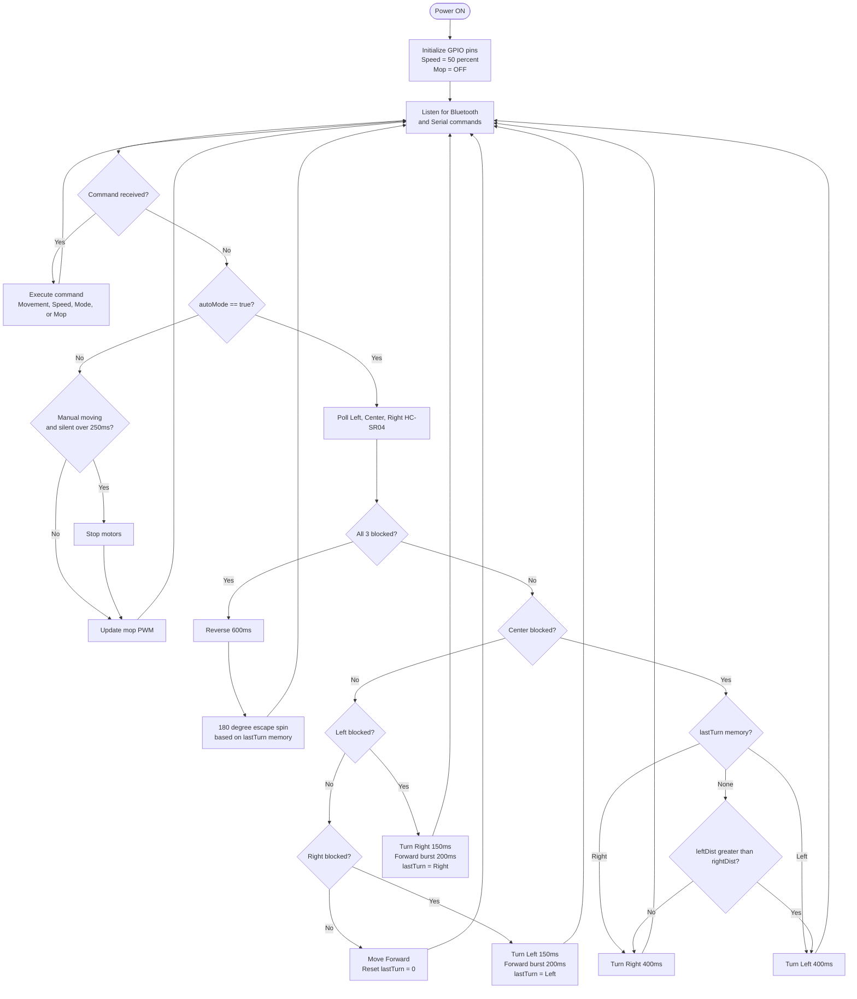

<div align="center">

# Autonomous Floor-Cleaning Robot

[](https://opensource.org/licenses/MIT)
[](https://www.arduino.cc/)
[](https://isocpp.org/)
[](https://flutter.dev/)
[]()
[](https://sdgs.un.org/goals/goal11)

**A dual-mode, Arduino-powered smart cleaning rover** featuring a 3-point ultrasonic sensor array, a memory-based obstacle bypass algorithm, independently controlled mop motor, and a custom Flutter companion app with Bluetooth serial communication.

*B.Tech Computer Science Engineering — Chitkara University, Punjab*

---

</div>

## Table of Contents

- [Project Overview](#project-overview)
- [Key Features](#key-features)
- [Project Demo](#project-demo)
- [Hardware Components](#hardware-components)
- [Software & Technologies](#software--technologies)
- [System Architecture](#system-architecture)
- [Working Principle](#working-principle)
- [Circuit Connections](#circuit-connections)
- [Installation & Setup](#installation--setup)
- [Algorithm / Workflow](#algorithm--workflow)
- [Applications](#applications)
- [Advantages & Limitations](#advantages--limitations)
- [Future Enhancements](#future-enhancements)
- [Testing & Results](#testing--results)
- [Learning Outcomes](#learning-outcomes)
- [Project Structure](#project-structure)
- [Resume Description](#resume-description)
- [License & Acknowledgements](#license--acknowledgements)

---

## Project Overview

Manual floor cleaning is time-consuming, physically repetitive, and often neglected in high-traffic environments. The **Autonomous Floor-Cleaning Robot** addresses this by providing a self-navigating rover capable of continuously covering a floor area while avoiding obstacles — without human intervention.

The robot operates in two distinct modes:

| Mode | Description |
|------|-------------|
| **Autonomous** | The robot navigates independently using three HC-SR04 ultrasonic sensors, executing a memory-based avoidance algorithm that prevents repetitive oscillation (wiggling) in corridors and corners. |
| **Manual (Bluetooth)** | A custom-built Flutter Android app communicates over HC-05 Bluetooth serial, giving the user full directional control, variable drive speed (25–100%), and independent mop speed control (0–100%). |

The cleaning mechanism uses a dedicated DC mop motor driven by a PWM-controlled NPN transistor switching circuit, allowing the mop to run at adjustable speeds independent of robot movement.

---

## Key Features

- **Dual-Mode Operation** — Seamless switching between Autonomous and Manual Bluetooth modes via app or serial command.
- **3-Point Ultrasonic Spatial Awareness** — Left, Center, and Right HC-SR04 sensors provide 180° obstacle detection coverage.
- **Memory-Based Bypass Algorithm** — A `lastTurn` variable prevents oscillation in corridors and corners by preserving the last successful turn direction.
- **Dead-End Escape Routine** — When all three sensors detect simultaneous blockage, the robot reverses then executes a near-180° spin to escape.
- **Independent Mop Speed Control** — Mop motor speed adjustable at 0%, 25%, 50%, 75%, and 100% via PWM, decoupled from drive motor state.
- **Hold-to-Move Manual Drive** — The app repeats movement commands every 100ms while a D-pad button is held; releasing sends an automatic stop.
- **Variable Drive Speed** — Four drive speed levels (25%, 50%, 75%, 100%) selectable in manual mode.
- **NPN Low-Side Mop Switch** — A transistor-based switching circuit safely drives the mop motor without exceeding Arduino GPIO current limits.
- **Custom Flutter Companion App** — Professionally designed glassmorphism-styled Android app with immersive landscape-lock UI.
- **3D-Printed Chassis** — All structural components (base plate, top plate, motor mounts, sensor brackets, mop wheel) custom-designed and 3D-printed.

---

## Project Demo

### Hardware Prototype

<p align="center">
  <b>Block Diagram</b><br>
  
</p>

<p align="center">
  <b>Circuit Diagram</b><br>
  
</p>

<p align="center">
  <b>Description Chart</b><br>
  
</p>

<p align="center">
  <b>Working Prototype</b><br>
  
</p>

<p align="center">
  <b>SDG Alignment</b><br>
  
</p>

### Demonstration Video

https://github.com/user-attachments/assets/627362c7-cbc1-4910-bca0-bf3ed4362df7

---

## Hardware Components

| Component | Part / Model | Role |
|-----------|-------------|------|
| **Microcontroller** | Arduino Nano (ATmega328P) | Central processing — reads sensors, runs navigation logic, drives outputs |
| **Motor Driver** | L298N Dual H-Bridge | Controls direction and PWM speed of both drive motors |
| **Drive Motors** | 2x DC Geared Motors | Differential-drive locomotion (left and right wheels) |
| **Cleaning Motor** | 1x DC Mop/Brush Motor | Spins the cleaning attachment |
| **Sensors** | 3x HC-SR04 Ultrasonic | Spatial obstacle detection: Left, Center, Right |
| **Bluetooth Module** | HC-05 (or HC-06) | Serial Bluetooth communication with the companion app |
| **Mop Switch** | NPN Transistor (e.g., TIP120) | Low-side switch to drive mop motor without overloading Arduino GPIO |
| **Flyback Protection** | 1N4007 Diode | Protects transistor from inductive voltage spikes |
| **Current Limiting** | 1kΩ Resistor | Limits base current into the NPN transistor |
| **Power Supply** | 2x 18650 Li-ion Batteries (7.4V total) | Powers motor driver, motors, and Arduino |
| **Chassis** | Custom 3D-Printed (8 STL parts) | Structural frame including base, top plate, motor mounts, sensor brackets, mop wheel |

### 3D-Printed Parts

All mechanical components were custom-designed and printed. STL files are in the [`3D Model/`](3D%20Model/) directory:

| File | Part |
|------|------|
| `(1)Base_Plate.stl` | Main chassis floor |
| `(1) Top_Plate.stl` | Upper deck for electronics mounting |
| `(1)Top Cover.stl` | Protective enclosure cover |
| `(1)Rear Cover.stl` | Rear panel |
| `(4)Motor_Mount_Block.stl` | Drive motor mounting blocks (x4) |
| `(1)Motor_Extender.stl` | Motor shaft extension |
| `(3)Sensor Mount Bracket.stl` | Ultrasonic sensor brackets (x3) |
| `Mop_Motor_Wheel_1.stl` | Mop/cleaning wheel (~7 cm diameter) |

---

## Software & Technologies

| Layer | Technology | Purpose |
|-------|-----------|---------|
| **Embedded Firmware** | C++ / Arduino IDE | Robot logic, sensor polling, motor control |
| **Communication Library** | `SoftwareSerial.h` (built-in) | Bluetooth serial on Arduino pins D10/D11 |
| **Mobile App Framework** | Flutter (Dart) — SDK `^3.4.3` | Cross-platform Bluetooth controller app |
| **Bluetooth App Library** | `flutter_bluetooth_serial ^0.4.0` | Discover, pair, and communicate with HC-05 |
| **Permissions** | `permission_handler ^12.0.1` | Android runtime Bluetooth/Location permissions |
| **App UI** | Material Design + Glassmorphism | Immersive landscape controller interface |
| **3D Design** | STL files (8 parts) | Custom mechanical chassis |
| **Development Environment** | Arduino IDE v1.8.x or v2.x | Firmware compilation and upload |

---

## System Architecture

The system is divided into three layers: **Input** (sensors + app), **Processing** (Arduino Nano), and **Output** (motors).



**Data flow:**
1. The Flutter app sends single-character ASCII commands over Bluetooth to the HC-05 module.
2. HC-05 forwards commands to the Arduino Nano via `SoftwareSerial` (pins D10/D11).
3. In Autonomous mode, the Arduino polls the three ultrasonic sensors every loop iteration and runs the navigation algorithm.
4. The Arduino drives the L298N H-bridge for locomotion and the NPN transistor gate for mop speed control.

---

## Working Principle

### Step-by-Step Operation

1. **Power On / Initialization**  
   The Arduino initializes all GPIO pins, sets drive speed to 50% (PWM = 128), disables the mop motor, and begins listening on hardware serial (USB) and software serial (Bluetooth).

2. **Mode Selection**  
   - Receiving `'A'` activates **Autonomous Mode**.
   - Receiving `'M'` or `'P'` switches to **Manual Mode** and stops all motors.

3. **Autonomous Sensor Polling** *(executed every loop iteration when `autoMode == true`)*  
   - Each HC-SR04 is triggered with a 10µs HIGH pulse on its TRIG pin.
   - Echo duration is measured via `pulseIn()` with a 30ms timeout.
   - Distance (cm) = `duration × 0.034 / 2`.
   - Readings exceeding 400 cm or timed-out readings are treated as "clear" (returned as 999 cm).

4. **Obstacle Classification**

   | Sensor Direction | Blocked if distance < |
   |-----------------|----------------------|
   | Center | 20 cm |
   | Left | 15 cm |
   | Right | 15 cm |

5. **Navigation Decision** *(evaluated in priority order)*  
   - **All three blocked** -> Reverse (600ms) -> 180° escape spin using `lastTurn` memory.
   - **Center only blocked** -> Stop -> Turn toward the side with more clearance, or continue last turn direction to prevent wiggling.
   - **Left only blocked** -> Quick right dodge (150ms) -> Short forward burst (200ms).
   - **Right only blocked** -> Quick left dodge (150ms) -> Short forward burst (200ms).
   - **All clear** -> Drive forward; reset `lastTurn` to 0.

6. **Hold-to-Move Timeout** *(Manual Mode only)*  
   If no new movement command arrives within 250ms, motors are automatically stopped — ensuring the robot halts when the app button is released.

7. **Mop Motor Control**  
   The `mopSpeed` variable (0–255) is written to `MOP_MOTOR_PIN` (D5) via `analogWrite()` on every loop iteration, maintaining the last commanded cleaning speed regardless of drive motor state.

---

## Circuit Connections

> **Critical:** All components — Arduino, L298N, HC-05, and all sensors — **must share a common GND rail.**

### Master Pinout Table

| Component | Signal / Wire | Arduino Nano Pin | Type | Notes |
|-----------|--------------|-----------------|------|-------|
| **L298N Motor Driver** | ENA (Right Motor Speed) | `D6` | PWM Output | Must be PWM-capable pin |
| | IN1 (Right Motor Forward) | `D7` | Digital Output | |
| | IN2 (Right Motor Backward) | `D8` | Digital Output | |
| | ENB (Left Motor Speed) | `D9` | PWM Output | Must be PWM-capable pin |
| | IN3 (Left Motor Forward) | `D12` | Digital Output | |
| | IN4 (Left Motor Backward) | `D13` | Digital Output | |
| **HC-05 Bluetooth** | TXD (module TX) | `D10` (SW-RX) | Digital Input | `SoftwareSerial(10, 11)` |
| | RXD (module RX) | `D11` (SW-TX) | Digital Output | Use voltage divider — HC-05 RXD is 3.3V logic |
| **Left HC-SR04** | TRIG | `A0` | Digital Output | |
| | ECHO | `D2` | Digital Input | |
| **Center HC-SR04** | TRIG | `A1` | Digital Output | |
| | ECHO | `D3` | Digital Input | |
| **Right HC-SR04** | TRIG | `A2` | Digital Output | |
| | ECHO | `D4` | Digital Input | |
| **Mop Motor** | NPN Base | `D5` | PWM Output | Via 1kΩ series resistor |
| | Flyback Diode | Across mop motor terminals | — | Cathode (stripe) toward +V terminal |

### NPN Mop Switching Circuit

```
Arduino D5 ──[1kΩ]──► NPN Base
                       NPN Collector ──► Mop Motor (–)
                       NPN Emitter  ──► GND
           Mop Motor (+) ──► Battery +V
           [1N4007 diode across motor: Anode→(–), Cathode→(+)]
```

---

## Installation & Setup

### Prerequisites

| Tool | Version | Link |
|------|---------|------|
| Arduino IDE | v1.8.x or v2.x | [arduino.cc/en/software](https://www.arduino.cc/en/software) |
| Flutter SDK | `^3.4.3` | [flutter.dev/docs/get-started](https://flutter.dev/docs/get-started/install) |
| Android Studio | Latest stable | Required for Flutter Android builds |

### 1. Hardware Assembly

1. 3D-print all STL parts from the [`3D Model/`](3D%20Model/) directory.
2. Mount the two geared DC motors into `Motor_Mount_Block` brackets and secure to the base plate.
3. Mount the L298N driver and Arduino Nano on the base plate.
4. Attach the three HC-SR04 sensors to their `Sensor Mount Bracket` parts at the front of the chassis.
5. Wire all components per the [Circuit Connections](#circuit-connections) table above.
6. Assemble the mop wheel from `Mop_Motor_Wheel_1.stl` and attach to the mop motor shaft.
7. Secure the HC-05 module; use a voltage divider on the Arduino TX -> HC-05 RXD line for 3.3V compatibility.
8. Connect the 7.4V battery pack to the L298N power input. The L298N 5V regulator output can power the Arduino's VIN.

### 2. Firmware Upload

```bash
# 1. Clone the repository
git clone https://github.com/Vans30m/Autonomous-Floor-Cleaning-Robot.git

# 2. Extract the Arduino sketch from Code.zip
#    -> Code/LAST_FINAL_CODE_ROBOT/LAST_FINAL_CODE_ROBOT.ino

# 3. Open in Arduino IDE: File -> Open -> LAST_FINAL_CODE_ROBOT.ino

# 4. Configure board and port:
#    Tools -> Board -> Arduino Nano
#    Tools -> Processor -> ATmega328P (try "Old Bootloader" if upload fails)
#    Tools -> Port -> COMx (your Arduino's port)

# 5. Click Upload
```

No additional libraries are required — only the built-in `SoftwareSerial.h` is used.

### 3. Flutter App — Install Pre-Built APK (fastest)

```bash
# Enable "Install from Unknown Sources" in Android Settings, then transfer and open:
App (apk)/floor_cleaning_robot_controller_app.apk
```

### 4. Flutter App — Build from Source

```bash
cd FlutterApp/floor_cleaning_robot_app

flutter pub get          # Install dependencies
flutter build apk --release
flutter install          # Deploy to connected Android device
```

### 5. Running the System

1. Power on the robot.
2. Pair your Android phone with the HC-05 via Android Bluetooth Settings (default PIN: `1234` or `0000`).
3. Open the **Floor Cleaning Robot Controller** app.
4. Select the HC-05 device from the dropdown and tap **INITIALIZE**.
5. Use the D-pad for manual drive control; tap **ENGAGE** to activate autonomous mode; tap **OVERRIDE** to cancel it.
6. Use the **MOP TURBINE** panel to set cleaning speed (OFF / 25% / 50% / 75% / MAX).

---

## Algorithm / Workflow



### Bluetooth Command Reference

| Command | Action |
|:-------:|--------|
| `F` | Move Forward |
| `B` | Move Backward |
| `L` | Turn Left |
| `R` | Turn Right |
| `P` | Pause (Stop Motors) |
| `A` | Engage Autonomous Mode |
| `M` | Manual Override (Autonomous OFF + Stop) |
| `S` | Drive Speed 25% |
| `T` | Drive Speed 50% |
| `C` | Drive Speed 75% |
| `X` | Drive Speed 100% |
| `G` | Mop OFF |
| `H` | Mop 25% |
| `I` | Mop 50% |
| `J` | Mop 75% |
| `K` | Mop 100% (MAX) |

---

## Applications

| Environment | Use Case |
|-------------|----------|
| **Residential** | Continuous hard-floor cleaning in living rooms, kitchens, corridors |
| **Offices & Classrooms** | Scheduled automated cleaning during off-hours |
| **Laboratories** | Dust-sensitive spaces requiring frequent, low-disruption maintenance |
| **Small Retail Spaces** | Overnight or between-hours floor upkeep |
| **Educational / Research** | Robotics learning platform for autonomous navigation, sensor integration, and embedded systems |

This project aligns with **UN SDG Goal 11 — Sustainable Cities and Communities** by promoting smart, low-effort urban living environments.

---

## Advantages & Limitations

### Advantages

- **No mapping required** — Reactive obstacle avoidance works in any room layout without prior configuration.
- **Dual-mode flexibility** — Manual Bluetooth override enables precise control in areas where autonomous navigation is impractical.
- **Modular mop control** — Independent mop speed allows use as a dry sweeper or at various wet-mop intensities.
- **Low-cost hardware** — Built from widely available, inexpensive components (Arduino Nano, L298N, HC-SR04).
- **Reproducible chassis** — All mechanical parts are 3D-printable with provided STL files.
- **Anti-wiggle memory** — Prevents the common failure mode of oscillating indefinitely between two obstacles.

### Limitations

- **No coverage mapping** — The robot follows a reactive strategy; it does not memorize visited areas or guarantee full floor coverage.
- **Timer-based turns** — Turn durations (150ms, 400ms, 800ms) are empirically tuned and may need re-calibration for different surface friction or battery charge levels.
- **Single-plane sensing** — HC-SR04 sensors detect objects at a fixed height; low obstacles (cables, small toys) or overhanging objects may be missed.
- **Bluetooth range** — Manual mode is limited to HC-05 Bluetooth range (~10m line-of-sight).
- **No battery monitoring** — Battery voltage is not tracked; performance degrades silently as batteries discharge.
- **Android only** — The companion app currently targets Android only.
- **No return-to-base** — The robot has no docking or auto-charging capability.

---

## Future Enhancements

- [ ] **Coverage Path Planning** — Implement a boustrophedon (lawn-mower) or wall-following algorithm for systematic full-area coverage.
- [ ] **Mapping / SLAM** — Integrate a low-cost LiDAR or IR array to build an occupancy grid for tracked navigation.
- [ ] **Battery Monitoring** — Add a voltage divider + ADC circuit to report battery level to the app and trigger low-battery alerts.
- [ ] **IMU Integration** — Use an MPU-6050 for angle-based turns, replacing surface-friction-dependent timed turns.
- [ ] **iOS App Support** — Extend the Flutter app to support CoreBluetooth for iOS deployment.
- [ ] **Auto Return-to-Base** — Implement an IR/BLE home beacon and a docking routine.
- [ ] **Wi-Fi / IoT Control** — Replace HC-05 with an ESP8266/ESP32 for MQTT-based remote control and scheduling.
- [ ] **Live Camera Feed** — Add an ESP32-CAM module for real-time video streaming during manual operation.
- [ ] **Scheduled Cleaning** — Allow users to configure automated cleaning schedules from within the app.
- [ ] **Floor Type Detection** — Auto-adjust mop speed based on sensed surface resistance.

---

## Testing & Results

> **Note:** Results below reflect observed behavior during development. Quantitative metrics (coverage area %, cleaning efficiency) were not formally measured and are not reported.

| # | Test Case | Expected Outcome | Observed Result | Status |
|---|-----------|-----------------|-----------------|--------|
| TC-01 | Power-on initialization | Motors off, mop off, serial prints ready message | Serial console shows "Floor Cleaning Robot Ready!", motors quiet | Pass |
| TC-02 | Bluetooth pairing (HC-05) | App discovers and connects to HC-05 | Paired successfully | Pass |
| TC-03 | Manual forward drive | Robot moves forward while F held; stops on release | Forward motion; auto-stop ~250ms after release | Pass |
| TC-04 | Drive speed levels | Speed changes at 25% / 50% / 75% / 100% | Audible motor speed change at all four levels | Pass |
| TC-05 | Mop speed levels | Mop runs at commanded speed independent of drive | Mop operates at all five levels while stationary | Pass |
| TC-06 | Autonomous — open space | Robot drives forward continuously | Continuous forward movement with no false stops | Pass |
| TC-07 | Autonomous — front obstacle | Robot stops and turns away from wall | Stops, turns toward clearer side, resumes forward | Pass |
| TC-08 | Autonomous — side obstacle | Robot dodges away from blocked side | Quick dodge turn + forward burst executed | Pass |
| TC-09 | Autonomous — dead end (all blocked) | Robot reverses then executes escape spin | Reversal and ~180° spin observed; robot escapes | Pass |
| TC-10 | Anti-wiggle memory | Robot does not oscillate in narrow corridor | Consistent turn direction maintained via `lastTurn` | Pass |
| TC-11 | Manual override during auto mode | Sending 'M' stops autonomous mode immediately | Autonomous halted; motors stopped on command | Pass |
| TC-12 | Mop + autonomous simultaneous | Mop runs while robot navigates autonomously | Mop maintained at set speed throughout navigation | Pass |

---

## Learning Outcomes

This project provided hands-on development experience across multiple engineering domains:

- **Embedded C++ Programming** — Non-blocking, event-driven firmware using `millis()`, `pulseIn()`, and PWM for real-time control without delays in the main loop.
- **Sensor Integration** — Ultrasonic distance sensing with edge-case handling (timeout detection, out-of-range filtering).
- **Motor Control** — PWM-based speed control via H-bridge (L298N) for differential drive, and NPN transistor switching for inductive motor loads.
- **Hardware Circuit Design** — Multi-module circuit assembly including power distribution, flyback protection, and 3.3V/5V voltage compatibility.
- **Bluetooth Serial Communication** — Full-duplex serial link between a microcontroller and a mobile app using HC-05 and `SoftwareSerial`.
- **Mobile App Development** — Production-quality Flutter app with Bluetooth peripheral discovery, real-time command streaming, runtime permission handling, and animated UI.
- **3D Mechanical Design** — Designing printable structural components, iterating on fit/clearance tolerance, and integrating mechanical and electronic subsystems.
- **Algorithm Design** — Developing and debugging a stateful reactive navigation algorithm with memory-based anti-oscillation logic.
- **Systems Integration** — Combining firmware, hardware, mechanical assembly, and a mobile interface into a single cohesive working system.

---

## Project Structure

```
Autonomous-Floor-Cleaning-Robot/
│
├── 3D Model/                             # 3D-printable STL files
│   ├── (1)Base_Plate.stl
│   ├── (1) Top_Plate.stl
│   ├── (1)Top Cover.stl
│   ├── (1)Rear Cover.stl
│   ├── (1)Motor_Extender.stl
│   ├── (4)Motor_Mount_Block.stl
│   ├── (3)Sensor Mount Bracket.stl
│   └── Mop_Motor_Wheel_1.stl
│
├── App (apk)/
│   └── floor_cleaning_robot_controller_app.apk   # Pre-built Android APK
│
├── FlutterApp/
│   └── floor_cleaning_robot_app/
│       ├── lib/
│       │   └── main.dart                 # Full app UI and Bluetooth logic (~424 lines)
│       ├── pubspec.yaml                  # flutter_bluetooth_serial, permission_handler
│       └── ...
│
├── Images and Videos/
│   ├── Autonomous-Floor-Cleaning-Robot.png
│   ├── Block_Diagram.png
│   ├── CLEANING ROBOT (Circuit Diagram LABLED).png
│   ├── DESCRIPTION CHART.png
│   ├── SDG.png
│   └── Video with voiceover.mp4
│
├── Code.zip                              # Arduino firmware (compressed)
│   └── Code/LAST_FINAL_CODE_ROBOT/
│       └── LAST_FINAL_CODE_ROBOT.ino    # Main Arduino sketch (~380 lines)
│
├── LICENSE                               # MIT License
└── README.md
```

---

## Resume Description

> *Use the following bullet points in your B.Tech resume or portfolio. Adapt only if you have formally measured specific metrics.*

- **Designed and built** a dual-mode autonomous floor-cleaning robot using an Arduino Nano, L298N motor driver, 3x HC-SR04 ultrasonic sensors, and a custom NPN transistor mop switching circuit; implemented a memory-based reactive navigation algorithm that eliminates oscillation in corridor and corner environments.

- **Developed a Flutter Android companion app** with Bluetooth serial communication (HC-05), enabling real-time manual drive control with four speed levels, independent 5-step PWM mop speed control, and one-tap autonomous mode engagement — delivered via a glassmorphism-styled, immersive landscape UI.

- **Engineered a complete embedded system** from circuit design to working prototype — encompassing 3D-printed chassis design (8 custom STL parts), multi-module hardware assembly, Arduino firmware, and a mobile companion app — demonstrating end-to-end hardware-software co-design and systems integration.

---

## License & Acknowledgements

### License

This project is licensed under the **MIT License** — see the [LICENSE](LICENSE) file for full terms.  
© 2026 Vansh Thakur. Free to use for learning, experimentation, and non-commercial purposes with attribution.

### Acknowledgements

- **Chitkara University, Punjab** — Academic environment and project support.
- **Arduino Community** — Open-source hardware platform and documentation.
- **Flutter / Dart Team** — Cross-platform mobile development framework.
- **`flutter_bluetooth_serial`** package contributors — Bluetooth serial abstraction for Flutter.
- **HC-SR04 & L298N datasheets** — Reference documentation for hardware integration.
- **UN Sustainable Development Goals** — Framework for real-world impact alignment (SDG 11: Sustainable Cities and Communities).

---

<div align="center">

**Vansh Thakur**  
B.Tech Computer Science Engineering (Core)  
Chitkara University, Punjab  

[](https://github.com/Vans30m)

*Built with curiosity, dedication, and engineering rigor.*

</div>
